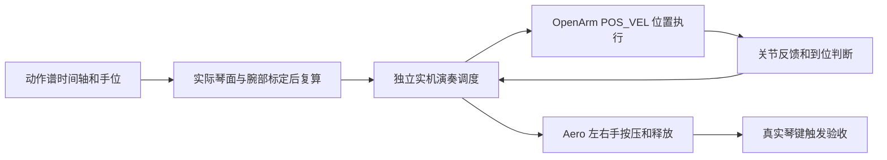

# 《槿》OpenArm 双臂与 Aero Hand 实机联调方案

2026-11-18。曲目为 60 BPM 含前奏版，原谱 264 秒，508 次单键按下，22 段移臂，6 个目标手位。状态与后续验收记录维护在 [仿真实机联通实施计划](仿真与实机联通_两日实施计划.md)。

**冗余选解后，1× 的 22 段换位均通过 24 V 额定速度和官方控制库可选速度帽检查。** 1× 仍受加速度与落指时间限制。当前离线联调候选为 **0.35×（21 BPM）**，首轮实机从开头固定手位和两类换位节选开始。原姿态与首次候选的比较仍用于识别限速瓶颈。数据包没有执行授权。

## 1. 已导出的数据

| 数据 | 内容 | 实机使用时的处理 |
| --- | --- | --- |
| 曲谱和按指事件 | 含前奏、音高、源行号、绝对微秒时间、左右手、指法、按下和抬起 | 原谱作为目标节奏，按实测速度选择倍率 |
| 6 个手位 | 左 18、19、20，右 24、25、29。每个手位保存 7 维模型关节角、仿真掌部位置和四元数、逐轴位置余量、仿真按压量 | 用实际琴面与腕部工具坐标复算或修正，仿真按压量仅供参考 |
| 22 段关节轨迹 | 双臂各自的起止模型关节角、时限、逐轴峰值速度和加速度、可移动时间边界、0.25× 候选起止时刻 | 用实测起姿重新生成首段，校验限位、机械余量、碰撞和指尖到位条件 |
| 参考与候选姿态 | 基础 JSON 顶层为网页仿真原姿态，`candidate` 为首次候选。冗余逆解证据的 `selected` 保存当前 0.35× 候选姿态、关节轨迹和换位窗口，沿用基础 JSON 的按指事件 | 以当前候选姿态为初值，在实际琴上完成校核后再形成执行请求 |

原仿真右手 24、25 号位的 J2 与位置上限相差约 `6.4e-9 rad`。替代姿态仍通过抬指、单指和四指同时触键检查，右 24、25、29 号位的最小逐轴位置余量分别为 **7.805°、8.981°、14.620°**。六个候选手位的最小余量为左 20 号位的 **2.178°**。重新求解保留音高、指法和换位顺序。 [候选计划数据](槿60BPM实机候选数据_20261118.json) · [原动作谱](../../openarm/skills/paino_skill/scores/槿（60%20BPM%20含前奏）.txt)

## 2. 原姿态与首次候选的 1× 限幅和时间

审核先用官方 V1 模型的位置范围，再对比同型号 24 V 输出轴额定速度和控制库可选速度帽。位置范围按当前逻辑方向转换。可选速度帽用于候选计算，额定力矩仅作为规格和反馈保护依据。实机带负载的可用加速度、到位稳定时间、关节跟踪误差由现场测量确定。 [关节规格](../../关节详细资料.md) · [模型限幅和速度来源](OpenArm关节限幅核查_20261116.md)

| 双臂同编号轴 | 24 V 额定速度 | 官方控制库可选速度帽 | 24 V 额定力矩 |
| --- | ---: | ---: | ---: |
| J1、J2 | 10.472 rad/s | 2.00 rad/s | 20 N·m |
| J3、J4 | 3.770 rad/s | 3.14 rad/s | 9 N·m |
| J5、J6、J7 | 12.566 rad/s | 6.30 rad/s | 3 N·m |

每段沿用仿真的静止到静止五次插补，逐轴计算 `v_peak = 1.875 × |Δq| / T` 和 `a_peak = (10/√3) × |Δq| / T²`。每段所需时间取所有轴的最大值。位置插值单调，端点都在官方范围即保证这一插值段的关节位置范围，整段避碰仍需检查。

| 1× 超额定速度段 | TXT 行号 | 曲谱时间 | 原姿态 J3 峰值 | 原姿态仅按额定速度所需时间 | 候选姿态 J3 峰值 | 候选仅按额定速度所需时间 |
| --- | --- | --- | ---: | ---: | ---: | ---: |
| 右手 25→24，共四段 | 31、55、133、907 | 分别为 6.875–7、10.875–11、22.875–23、150.875–151 s | 4.763 rad/s | 0.158 s | 4.867 rad/s | 0.161 s |
| 右手 24→29 | 1243 | 195–195.25 s | 6.842 rad/s | 0.454 s | 4.472 rad/s | 0.297 s |

这五段的原谱窗口从同手上一音的抬指指令开始，到下一音的按指指令截止。原谱没有可直接挪用的空白时间。速度单项给出的整曲理论倍率上限是原姿态 **0.551×**，候选姿态 **0.775×**。再考虑官方控制库可选速度帽，分别是 **0.459×** 和 **0.645×**。这些数字仅用于找瓶颈；加速度和实机响应会改变可用倍率。

### 首次候选时间预算

- 离线计算用 **20 rad/s²** 作逐轴加速度试算值，取额定速度与可选速度帽的较小值。留 **50 ms** 抬指、**50 ms** 到位稳定与反馈确认、**50 ms** 从发按指到触键，共 **150 ms**。这些是待替换的输入。首次实测从已验收的低速小步动作开始。
- 候选 25→24 的运动至少 **0.308 s**，含上述预留需 **0.458 s**。0.25× 给 **0.500 s**，模型预算余量 **42 ms**。候选 24→29 的运动至少 **0.415 s**，含预留需 **0.565 s**，0.25× 给 **1.000 s**。左 19→20 的 0.125 s 段在 1× 也缺到位及按指预算，降速后包含在预检中。
- 原谱最短按指持续 **62.5 ms**，同指重击的最短释放间隔 **31.25 ms**。0.25× 对应 **250 ms** 和 **125 ms**。实测需分别检查手指能否在最长允许时间内按下、抬起，并触发正确的琴键。全曲 0.25× 为 **17 分 36 秒**，其中开场准备按同一倍率缩放为 16 秒。
- 实机测到抬指、换位、稳定、按指的时间后，用其组合上界复算 `可用倍率 ≤ 曲谱窗口 / 所需总时间`。某段达不到就降低倍率或重新编排同手移位。保留起音拍点需要改变前一音保持时间、减少换位，或重新分配手位和指法。改编后重做整曲触键校验。

### 冗余选解复核 · 2026-11-18

在相同末端目标下，用 MuJoCo 手掌雅可比的零空间选取不同关节初值，并由官方 IK 回到原末端目标。筛选逐轴位置余量至少 2°，再用现有检查器验证抬指、单指和四指同时触键。右手 24、25、29 号位分别留下 98、157、208 个样本。以全曲 22 段的最大逐轴速度占比排序，对选出的组合用原曲时间回放。该组合在右手三个手位的最小关节余量分别为 **3.85°、8.79°、13.73°**，原谱 1× 的 508 次触键逐一匹配。 [冗余逆解数据与复核结果](../../logs/openarm/sync/jin_redundant_ik_20261118.json)

| 换位 | 首次候选的 J3 峰速 | 冗余解的 J3 峰速 | 冗余解的运动与触键试算时间 |
| --- | ---: | ---: | ---: |
| 右手 25→24 | 4.867 rad/s | 0.280 rad/s | 0.308 s |
| 右手 24→29 | 4.472 rad/s | 2.091 rad/s | 0.435 s |

25→24 的 J2 峰速从 0.308 增至 1.292 rad/s，J3 位移和其他若干轴同时减小。新组合的最高 24 V 额定速度占比为 **55.9%**，发生在 24→29 的右 J4（2.106 rad/s）。该组合的短换位峰值加速度仍为 **32.0 rad/s²**，四段窗口各只有 0.125 s。按原先的 20 rad/s² 与抬指、稳定、落指共 150 ms 预算，整曲理论倍率上沿 **0.406×**。选 **0.35×** 复核 22 段逐轴速度与加速度，最小预算余量 **49 ms**，754.286 秒受控时钟回放中 508 次触键精确匹配。预算参数留待实测替换。实机冲击 1× 时，从加速度和手部响应实测、扩大可用换位窗口入手。

### 冗余解逐轴峰速与 60 BPM 验收门槛

用当前冗余解的 22 段 `q0/q1` 和五次插补从头复算。表中速度取每轴全曲绝对值峰值，单位为 rad/s，包含仿真起姿到开场的准备段。21 BPM 列使用扣除每段 150 ms 预留后的实际运动时长。所有数值为目标轨迹计算结果，实机反馈单独记录。

| 关节 | 左 60 BPM | 右 60 BPM | 左 21 BPM | 右 21 BPM | 24 V 额定 | 官方控制库可选速度帽 |
| --- | ---: | ---: | ---: | ---: | ---: | ---: | ---: |
| J1 | 0.239 | 1.298 | 0.122 | 0.575 | 10.472 | 2.00 |
| J2 | 0.809 | 1.293 | 0.488 | 0.780 | 10.472 | 2.00 |
| J3 | 0.341 | 2.091 | 0.206 | 0.926 | 3.770 | 3.14 |
| J4 | 0.483 | 2.106 | 0.292 | 0.933 | 3.770 | 3.14 |
| J5 | 0.317 | 1.162 | 0.192 | 0.515 | 12.566 | 6.30 |
| J6 | 0.818 | 0.510 | 0.494 | 0.226 | 12.566 | 6.30 |
| J7 | 0.206 | 0.872 | 0.124 | 0.386 | 12.566 | 6.30 |

60 BPM 对比按原谱完整移动窗口计算。全程最紧的额定速度占比为右 J4 的 **55.9%**，官方控制库可选速度帽占比为 **67.1%**。21 BPM 扣除预留后的全曲峰值加速度为 **11.65 rad/s²**。 [冗余解逐段数据](../../logs/openarm/sync/jin_redundant_ik_20261118.json)

| 60 BPM 紧张段 | 原谱窗口 | 不留额外时间的五次插补峰值加速度 | 按 20 rad/s² 的最短运动时间 | 再加 150 ms 预留 | 须从前一音释放的额外时间 |
| --- | ---: | ---: | ---: | ---: | ---: |
| 右 25→24，四次 | 125 ms | 32.00 rad/s² | 158 ms | 308 ms | 183 ms |
| 左 19→20，第 985 行 | 125 ms | 20.16 rad/s² | 125.49 ms | 275.49 ms | 150.49 ms |
| 右 24→29，第 1243 行 | 250 ms | 25.94 rad/s² | 285 ms | 435 ms | 185 ms |

- **125 ms 短段的加速度下限。** 右 25→24 的 J4 转动约 0.0866 rad。两端速度为零时，即使允许最快的分段常加减速，所需峰值加速度也至少为 `4 × |Δq| / T² = 22.17 rad/s²`。原 20 rad/s² 试算值下，单靠更换插补曲线无法在 125 ms 内完成该转动。
- **实测到位窗口。** 对最短右手段，按额定速度计算，可给抬指、稳定和落指的合计上限为 **81.9 ms**。沿用官方控制库可选速度帽时，上限收紧到 **44.3 ms**。即使实测合计仅 25 ms，剩余 100 ms 的五次插补仍要求 **50.0 rad/s²**。这些是达到原节拍的计算门槛，需用负载下 POS_VEL 测得的到位时间和 Aero 响应判断。另需独立验证同指重击的 **31.25 ms** 间隔。
- **提前抬指的边界。** 右手五段可以从前音保持时间中借出约 183–185 ms，再检查听感和实机触键。左手第 985 行前一音只保持 **125 ms**，现有预算要求借出 **150.49 ms**，所以仅缩短前音时值仍差 **25.49 ms**。若实测预算接近本表，要保留 60 BPM 的全部起音，左手这一段还需重编手位或指法。

## 3. POS_VEL 实机链路



**机械臂。** 复用现有逻辑角和电机角映射。主机按共用时间轴计算平滑位置目标，按已确认的电机模式发送位置和正的速度上限。模式读回必须为 `CTRL_MODE=2`。速度上限是固件限制值，用于限制对位置目标的追踪。连续目标的下发周期、反馈新鲜度和固件内部轨迹行为先在空中实测，确保双臂不会因各轴独立追踪而错过到位时刻。当前双臂 CAN 执行入口的使能和运动仍按 MIT 校验。独立 POS_VEL 执行分支及固件特定使能、停止和首目标语义按 C02–C05 验证。 [位置模式切换方案](OpenArm14关节位置模式切换方案_20261117.md) · [现有轨迹执行器](../../apps/drive_openarm_from_sim.py)

**手指与节拍。** `D/U` 映射成实机每手独立标定的按下和抬起位置。换位开始前确认对应手已抬离琴面，移臂在候选起止窗口内完成，随后确认关节反馈误差和稳定状态。按指可按实测响应提前下发，目标是指尖在原定拍点触键。双臂 CAN 与两手串口由各自的唯一工作线程管理，共用单调时间基准。同一手同一时刻的和弦手指合并下发。到位或抬指确认超时就取消后续动作，故障收尾依赖已验证的模式停止和现场急停。 [Aero 手指部署与调度](../../openarm/tools/aero_score/README.md)

**末端精度。** POS_VEL 的电机位置环有利于跟踪关节位置。指尖能否落到键中心仍取决于琴面坐标、腕部安装、连杆偏差与手指按压位置。每侧实测琴键中心、琴面高度、键距和工具坐标。关节反馈可用于计算指尖位置，验收还需要外测，例如固定相机或测量治具，记录横向、前后和垂向误差。空中定位和真实触键分开测量。

## 4. 现场验收顺序

| 阶段 | 验证内容 | 通过条件 |
| --- | --- | --- |
| A · 模式与设备 | 核对有独立总线所有者，备份各轴参数，验证 POS_VEL 首目标、保持、失能回读。核对左右手串口，补齐左手实机抬起和按下位置 | 参与轴模式和反馈有效，正常停止及断链行为可追溯。左右手逐指抬起、按下均有记录 |
| B · 空中定位 | 以原候选为初值复算六个手位，检查真实琴架、双臂、机械手和线缆净空。先站位再走 25→24 和 24→29，记录到位时间和外测误差 | 每个手位均达到按键几何要求，初始参考为落点误差≤2 mm、重复散布半径≤1 mm。最终容差按实际键面和指尖宽度核定 |
| C · 固定手位触键 | 用开头和弦的 F3、A3、C4、E4 从单指逐步到四音，夹带同指重复测试，测抬指、按下耗时和键程 | 音高正确，重复触键无漏音和邻键误触，抬指后确认离键 |
| D · 代表段联奏 | 先按低速验证前奏换位 25→24，再单独验证第 1243 行的旋律换位 24→29。记录同时段双臂跟踪、Aero 触键和调度日志 | 移臂到位并稳定后，仍有足够时间在下一拍触键。按键应与实测琴 MIDI 事件匹配，或由键程记录与视频复核 |
| E · 整曲与提速 | 用 D 的测量结果更新 22 段时间预算并预演，再执行通过现场复核的倍率。提速前重新检查五个瓶颈段 | 508 次目标白键触键完整，记录错音、漏音、最大起音偏差、关节跟踪和结束状态 |

## 5. 复算与验证

从项目根目录运行可重复导出。命令先读取同一个 JSON 中已选候选姿态并复验，然后重写报告。

```powershell
$review = '.\docs\project\槿60BPM实机候选数据_20261118.json'
.\openarm\.venv\Scripts\python.exe -B .\apps\plan_piano_hardware.py `
  '.\openarm\skills\paino_skill\scores\槿（60 BPM 含前奏）.txt' `
  --candidate-poses $review --output $review
```

候选数据保存动作谱、场景、映射文件的 SHA-256 和当前坐标版本。替代姿态在原拍点的虚拟时钟回放中匹配 508 次触键。将同一谱面缩放到 0.25×，并按候选数据留出每段 150 ms 后，再次离线回放全曲 1,056 秒。508 次触键的音高和计划起音时间逐一匹配，无漏音和额外触键。钢琴谱解析和场景回归 49 项通过。

该导出器仅调用仿真和离线限幅计算。报告使用 `offline_only=true` 和 `expires_at=0`。实机执行前需完成 POS_VEL 驱动验证、现场标定和按实测数据复算。 [离线导出器](../../apps/plan_piano_hardware.py)
