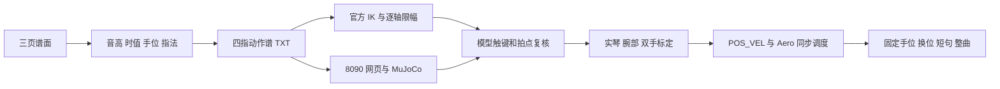

# 《槿》从曲谱到实机的全流程交接计划

更新于 2026-11-24 · Asia/Shanghai

适用场景为 OpenArm V1 双臂、Aero 双手和 C2–C7 的 61 键实琴。现行左食指原位 A3（实琴 13、曲谱 22），右食指原位 C4（实琴 15、曲谱 24）。下文含前奏版沿用当时的联调数据与从 A0 起算的曲谱白键号。[实琴编号与标定表](../../monitor-ui/README.md#实琴琴键与食指原位)

项目状态和每轮试验结论记录在两日实施计划。[联通实施计划](仿真与实机联通_两日实施计划.md)

## 1. 快速接手

| 项目 | 接手信息 |
| --- | --- |
| 本文联调基线 | 4/4，四分音符 60 BPM，C 调白键改编。含 8 小节前奏和三页谱面的人声主旋律。4 秒准备加演奏共 264 秒 |
| 联调基线数据 | 508 次按键，22 段移臂，6 个手位。该版冗余解在 60 BPM 通过逐轴速度审核和整曲仿真触键对照 |
| 联调候选 | 0.35×（21 BPM）。按 20 rad/s² 和每段 150 ms 抬指、稳定、落指预留试算，最小余量约 49 ms。MuJoCo 受控时钟回放的 508 次触键与计划一致 |
| 8090 仿真 | 选歌页搜索「实琴分手」，可选主旋律、纯和弦、副歌纯旋律。从仿真 B3/C4 原位回放时，三份谱的 1,815 音与谱面对应。从仿真默认姿态直接入位时准备段多出 E4。[现行曲谱及起姿对照](仿真与实机联通_两日实施计划.md#jin-score-library) |
| 8092 控制台 | 「钢琴原位」回左 A3、右 C4。纯和弦与完整钢琴版的首拍由左无名指 F3、左食指 A3、右食指 C4、右无名指 E4 奏出。整曲从 A3/C4 移至首腕位，等待 2 秒后按该曲倍率起奏。[操作说明](../../monitor-ui/README.md#钢琴定位与试弹) · [点位与验证](仿真与实机联通_两日实施计划.md#piano-a3-c4-xz) |
| 已有实机证据 | 11 月 19 日完成 14 轴 C02 只读盘点和 POS_VEL 切换回读。双臂原位与邻键定位的实琴对中仍待验。[盘点](../../logs/openarm/mode_switch/20261119_171446/inventory.json) · [模式回读](../../logs/openarm/mode_switch/20261119_171446/summary.json) |
| 现场下一步 | 先核对双手食指原位和各自相邻键的落点。补齐双腕错开时两侧的 J1～J7、手腕 XYZ 和食指对应键，供双手同时试弹复算。[实施记录](仿真与实机联通_两日实施计划.md#piano-adjacent-origin) |



## 2. 输入和证据索引

| 要找什么 | 文件与用途 |
| --- | --- |
| 原始谱面 | 第一页上部为前奏六线谱，下方简谱贯穿三页。按页核对减时线、附点、八度点、休止和延音。[第 1 页](../../resources/music_scores/jin/page-01.jpg) · [第 2 页](../../resources/music_scores/jin/page-02.jpg) · [第 3 页](../../resources/music_scores/jin/page-03.jpg) |
| 演奏 TXT | 正式演奏从现行曲库选谱。历史 508 音联调的含前奏原谱可按第 5 节从定版 ZIP 读取。[现行曲库](仿真与实机联通_两日实施计划.md#jin-score-library) · [历史原谱归档](../../docs/archive/piano-calibration/2026-11-24_B3-C4_定版及槿旧谱.zip) |
| 当前四指协议 | 改谱时核对左右手、连续四白键范围、移臂与 `D/U` 规则。 [四指动作谱规范](../../openarm/skills/paino_skill/SCORE_PROTOCOL.md) |
| 动作、音符、原关节解 | JSON 顶层 `finger_events` 保存 1× 绝对微秒时间、源行和 MIDI。`moves` 保存移臂，`sources` 保存关联文件哈希与映射版本。 [基础候选数据](槿60BPM实机候选数据_20261118.json) |
| 最新冗余解与回放结果 | `selected.hand_positions` 为 6 个当前手位，`selected.moves` 为 22 段关节角与换位窗口。`retimed_review` 保存 21 BPM 回放结果。与上行 JSON 的 `finger_events` 配套使用。 [当前关节解与证据](../../logs/openarm/sync/jin_redundant_ik_20261118.json) |
| 限幅、节拍、模式细节 | 原姿态和冗余解对比、14 轴峰速、现场测试顺序和模式切换所需核查项。 [联调和限幅方案](槿60BPM仿真到实机联调方案_20261118.md) · [POS_VEL 模式方案](OpenArm14关节位置模式切换方案_20261117.md) · [POS_VEL 目标配置](../../configs/openarm_position_mode.json) · [C02 盘点入口](../../apps/openarm_position_mode.py) |
| 场景与标定入口 | 实琴白键中心距 22.5 mm，按 A3／C4 两处原位与现场工具坐标校核。MuJoCo 用 A0–C8 的 88 键模型，白键中心距 23.5 mm。[实琴标定](../../monitor-ui/README.md#实琴琴键与食指原位) · [MuJoCo 场景配置](../../openarm/skills/paino_skill/scene.json) · [关节映射](../../configs/openarm_joint_mapping.json) · [Aero 指法接口](../../openarm/tools/aero_score/README.md) |

## 3. 分阶段工序和验收

### A. 谱面整理与 TXT 编排 · PIANO-J01

1. 记录来源页码、拍号、速度和改编范围。由谱面逐小节标出音高、起拍、时值、休止和跨小节延音。右侧附点改变时值，上下方的点用于八度。前奏从六线谱读取，人声从简谱读取。缺失或模糊的位置记录采用的解释和对应页码。
2. 将音高映射成白键，选择手位与指法。既有 TXT 编码以 A0 为白键 1，左手四指用 `1234`（曲谱白键 1～23），右手四指用 `789x`（曲谱白键 24～52）。实琴 C2–C7 对应曲谱白键 10～45。`index` 指本手覆盖的最左白键。每次换位应有前一音释放、移动和下一音触键的时间窗口。
3. 写动作 TXT 并解析。`sleep` 推进绝对时间，移臂可以与另一侧并行，`hand(D/U,…)` 保留按压或抬起状态。保留小节注释。若调整音高、八度、和弦、装饰音、时值或手指分配，把变更记到谱头和本轮记录。

**验收。** 历史含前奏基线为 264 秒、508 次下键、22 段移臂，音域 D3～D5。开头含 4 秒准备，人声在前奏第 8 小节末拍进入。演奏现行曲谱时按所选谱的音数和时长验收，同时逐小节复查拍数、跨小节延音、源行和目标音高。

### B. 手位求解与硬件限幅审查 · PIANO-J01

1. 从当前场景的预检获取每个手位的手掌目标、7 维关节解和各指按压量。检查抬指时不触键、每指单独压准、四指同时压准。计划角度单位 rad，空间坐标单位 m，姿态四元数顺序 wxyz，事件时间用整数微秒。
2. 从实测或仿真起姿建立各段起止 `q0/q1`，用同一插补规则核对位置、速度、加速度与窗长。若某轴超限或裕量过小，用官方 IK 搜索保留手掌目标的其他关节解。按全曲最紧关节占比比较，检查改解后的触键和路径净空。
3. 本曲手位为左 **18、19、20**，右 **24、25、29**。60 BPM 的冗余解最高为右 J4 **2.106 rad/s**，占其 24 V 额定值 **55.9%**。速度过关后，仍须检查该段能否完成抬指、换位、稳定和落指。实机初始角和工具坐标变化时，先重算，再产生当轮候选。

**验收。** 六个手位逐一通过接触检查，22 段各有起止角、时限、限制轴及速度、加速度和位置裕量证据。计划引用的场景、坐标约定、映射、曲谱和候选版本可以核对。 [14 轴峰速和 60 BPM 门槛](槿60BPM仿真到实机联调方案_20261118.md#冗余解逐轴峰速与-60-bpm-验收门槛)

### C. 网页、仿真和触键对照 · PIANO-J01

1. 双击根目录的 [02-钢琴弹奏+MuJoCo.cmd](../../02-钢琴弹奏+MuJoCo.cmd)。在 [8090 钢琴演奏页](http://127.0.0.1:8090/) 选主旋律、纯和弦或副歌纯旋律，以 1× 播放。对应仿真进程使用 8769。复现历史含前奏基线时使用第 5 节的离线回放。
2. 浏览器解析后发送整谱预检，MuJoCo 按绝对时间执行动作。检查网页进度、发声，以及仿真返回的 `on/off` 事件。网页瀑布音符反映谱面进度，音高验收以 MuJoCo 触键事件为据。若采集网页联播数据，应从开始前取得事件 ID，并在演奏时按 `/api/piano?after=<id>` 增量取事件。服务仅保留最近 512 条，因此完整、可重复的触键对照走第 5 节离线回放。
3. 第 5 节的回放命令重验并使用当前冗余解。先用原时间做 1× 回放。再按候选移臂起止时刻和 `D/U` 时间除以 0.35 后的微秒时间，复核 21 BPM。8090 普通导入用于原谱复核，页面倍速范围为 **0.5–2.0×**。

**验收。** 记录实际采用的 TXT、手位解、倍速和起姿。按所选谱核对触键与释放。历史含前奏基线的 508 次目标触键、原谱冗余解及 21 BPM 回放结果可在第 5 节查阅。

### D. 实机准备和阶梯验收 · PIANO-J02/J03

| 顺序 | 要完成的动作 | 通过时归档的证据 |
| --- | --- | --- |
| 1. 位置模式链路 | PCAN 恢复后先完成 C02 只读备份，再核对各轴固件、模式变更、当前位置首目标、使能和停止语义。使用独立实机执行分支，保持 CAN 只有一个所有者 | 14 轴盘点备份、`CTRL_MODE=2` 参与轴回读、正常及异常停止结果和逐周期目标与反馈。 [C02–C06 模式方案](OpenArm14关节位置模式切换方案_20261117.md#4-现场分阶段实施) |
| 2. 标定与空中到位 | 以左食指 A3、右食指 C4 为原位，分别实测对键、琴面高度、腕部安装到指尖的工具变换和按抬位置。左右手独立核对按抬位和接线 | 现场标定文件、起姿和映射版本、指尖落点、双掌与琴架净空 |
| 3. 固定手位触键 | 在开头手位验证左手 F3/A3、右手 C4/E4。从单指、同指重击到双手和弦。测指尖离键、实际起音和抬落指时间 | 每次目标和实际琴音、响应时间、键程或 MIDI 数据。明确现场误差和离键判据 |
| 4. 三类换位与短句 | 先验证下表的三类换位。双臂位置反馈和 Aero 指令共用一个单调时钟。动作前确认该手离键，落指前确认到位并稳定。任一前置动作失时，停止后续演奏并走已验收的抬指、停臂流程 | 每段实际到位时间、最紧时间余量、正确触键、峰值速度和跟踪误差。记录通信错误与停止回读 |
| 5. 整曲与提速 | 用当轮实测填写 22 段时间预算和 31.25 ms 同指重击校核。先确认低速短句，再用通过复算的倍率演奏整曲。每次提速保留对应轨迹和验收数据 | 目标与实际音高、时序差、漏音、多音、各轴反馈。实机完成记录同时包含最终停止状态 |

以下时间按原谱 1× 计，包含 4 秒准备。`index` 指四指手位起始白键。

| 换位试验 | 原谱位置 | 目标动作 | 原谱窗口 |
| --- | --- | --- | ---: |
| 右手短移位 | 第 1 页前奏第 1、2、5 小节和第 2 页主旋律第 11 小节。TXT 行 31、55、133、907 | 25→24。G4 抬起后落 F4，最后一次落 C4 | 每次 125 ms |
| 左手短移位 | 第 2 页主旋律第 14 小节。TXT 行 985，163.375–163.500 秒 | 19→20，A3 → B3 | 125 ms |
| 右手长移位 | 第 2 页主旋律第 22 小节。TXT 行 1243，195.000–195.250 秒 | 24→29，E4 → C5 | 250 ms |

**判断 60 BPM 是否通过。** 对每段核算 `抬指确认 + 带载移臂到位 + 稳定确认 + 发按指至触键 ≤ 谱面窗口`。同时检查逐轴跟踪和同指重击。当前 1× 仿真与峰速通过，20 rad/s² 加速度和 150 ms 预留下原谱节拍仍有超时段。若现场预算接近试算，优先复核左手 19→20，因为仅缩短前一音的保持时间仍差 25.49 ms。21 BPM 是离线模型验证过的候选，现场测试速度由实测决定。 [详细时间预算](槿60BPM仿真到实机联调方案_20261118.md#冗余解逐轴峰速与-60-bpm-验收门槛)

## 4. 现场和离线记录模板

每次试验在 `logs/openarm/sync/jin/<日期_时分秒>` 下保存本轮输入、复算 JSON、仿真或实机日志和总结。保留原始数据，结论引用具体文件及起止时刻。把阶段状态和证据链接更新到总计划的「快速接手」「阶段清单」「执行记录」。

```markdown
### YYYY-MM-DD HH:mm · 阶段 ID · 试验名称

- 试验人和范围：
- 状态：进行中 / 已完成（离线） / 已完成（实机） / 受阻
- 曲谱、场景、坐标映射、候选解的文件版本与 SHA-256：
- 现场条件：参与侧与关节、模式读回、标定版本、当轮起姿、总线所有者
- 倍率、试验谱行及预计动作：
- 实际使用的命令或界面入口：
- 结果：音符数、漏音、多音、起音误差、最迟到位时间、关节跟踪、末端外测
- 停止与读回：最终状态、确认时间、异常原始记录
- 证据路径及时间段：
- 恢复条件与下一步：
```

换位耗时用同一时间基准记录。建议表头为「试验编号、谱行、手别、原窗口 ms、发抬指、实际离键、移臂开始、到位稳定确认、发按指、真实起音、目标/实测 MIDI、余量 ms、结论」。发命令时间和实际触键时间都要记录；无法外测离键或触键时，标记使用的替代信号与精度。

## 5. 历史含前奏基线的离线复算与回放

在项目根目录用 PowerShell 运行。命令从现有证据提取当前冗余解，复算并离线回放两种速度。结果写入新的带时间目录。`review.json` 保存 508 次按键，`candidate` 保存 6 手位、22 段和约 0.049 s 最小余量。`replay.json` 应有 1× 和 0.35× 两项 `passed=true`，各自保存统计和逐条 `touch_events`，可按 `time_us`、`midi` 和手别查阅具体触键。 [离线回放入口](../../apps/replay_piano_review.py)

```powershell
$source = '.\logs\openarm\sync\jin_redundant_ik_20261118.json'
$run = Join-Path (Resolve-Path -LiteralPath '.\logs\openarm\sync').Path ('jin\' + (Get-Date -Format 'yyyyMMdd_HHmmss_fff'))
New-Item -ItemType Directory -Path $run -Force | Out-Null
$archiveDir = Join-Path $run 'archived-score'
Expand-Archive -LiteralPath '.\docs\archive\piano-calibration\2026-11-24_B3-C4_定版及槿旧谱.zip' -DestinationPath $archiveDir
$score = Join-Path $archiveDir '原始资料\openarm\skills\paino_skill\scores\槿（60 BPM 含前奏）.txt'
$poses = Join-Path $run 'selected_poses.json'
$review = Join-Path $run 'review.json'
$saved = Get-Content -Raw -Encoding UTF8 -LiteralPath $source | ConvertFrom-Json
$poseJson = @{ hand_positions = $saved.selected.hand_positions } | ConvertTo-Json -Depth 16
[IO.File]::WriteAllText($poses, $poseJson, [Text.UTF8Encoding]::new($false))
.\openarm\.venv\Scripts\python.exe -B .\apps\plan_piano_hardware.py `
    $score --candidate-poses $poses --candidate-rate 0.35 --output $review
if ($LASTEXITCODE -ne 0) { throw '曲谱复算失败' }
$result = Get-Content -Raw -Encoding UTF8 -LiteralPath $review | ConvertFrom-Json
[pscustomobject]@{
    HandPositions = $result.candidate.hand_positions.Count
    ArmMoves = $result.candidate.moves.Count
    NoteOns = $result.press_count
    MinSlackMs = [Math]::Round(1000 * $result.candidate.candidate_min_slack_s, 3)
} | Format-List
.\openarm\.venv\Scripts\python.exe -B .\apps\replay_piano_review.py `
    $review --output (Join-Path $run 'replay.json')
if ($LASTEXITCODE -ne 0) { throw '整曲仿真回放复核失败' }
$run
```

需要回归解析或场景代码时，在 `openarm` 目录运行 `.\.venv\Scripts\python.exe -B -m pytest skills/paino_skill/tests/test_score.py skills/paino_skill/tests/test_piano_scene.py -q`，再对照本曲 `replay.json`。

交接验收已执行上述复算和回放，1× 与 0.35× 各有 508 次目标下键和对应释放，整曲无遗漏或额外触键，49 项解析与钢琴场景回归通过。 [复算数据](../../logs/openarm/sync/jin/20261118_213325_355/review.json) · [整曲逐条触键记录](../../logs/openarm/sync/jin/20261118_213325_355/replay.json)

## 6. 变更后复查与更新

| 变更点 | 从哪里开始复查 | 更新什么 |
| --- | --- | --- |
| 换谱、改 BPM 或时值 | A | 受影响小节、按键时刻、音数、22 段窗口及受影响的仿真与实机结论 |
| 改分手、指法或手位 | A/B | 四指覆盖、换位前后对应琴键、关节解、触键和全曲回放 |
| 改模型、琴面、工具或关节坐标 | B | 关联哈希、实际起姿、位置限位、净空、指尖接触、运动与实测文件 |
| 改位置模式驱动、负载、保护或 Aero 标定 | D | 实测到位、释放和按压时延，逐段速度、加速度、余量和停止结果 |

交接签核时，从记录用「谱页/小节 → TXT 行 → 候选 `moves`/`finger_events` → 仿真事件 → 实机复测」抽查一个固定手位与一处换位，再从总计划确认当前阶段、通过范围和下一次第一项动作。

可用前奏第 1 小节做一次抽查。`review.json` 找 `candidate.moves` 中的 TXT 第 31 行，确认右手 25→24 在 6.875～7.000 秒。`replay.json` 取 `rate=1` 的 `touch_events`，应查到 G4（MIDI 67）在 6.875 秒释放，右手在 7.000 秒触发 F4（MIDI 65）。释放事件通过前一次同音 `on` 追溯手别。将来用相同的谱行和音高查实机记录。
