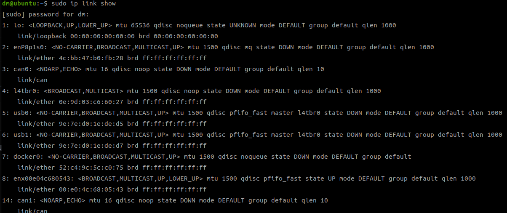
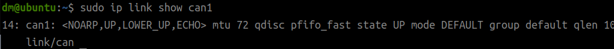

# SocketCAN C++例程

#### 本目录提供基于 Linux SocketCAN 的 C++ 电机控制示例，支持达妙单双路USB2CANFD模块
模块的SocketCAN专用固件 [gs_usb固件安装](https://gitee.com/kit-miao/dm-tools/tree/master/USB2CANFD/%E5%9B%BA%E4%BB%B6/socketcan/gsusb%E5%85%8D%E9%A9%B1%E5%9B%BA%E4%BB%B6)，烧录方式与普通固件一致；
***注意：模块安装SocketCAN专用固件后，将无法连接使用上位机！若要使用上位机，请先刷回普通固件***
如需刷回普通固件或升级SocketCAN固件，请下载 [USB2CANFD通用升级工具](https://gitee.com/kit-miao/dm-tools/tree/master/USB2CANFD%E9%80%9A%E7%94%A8%E5%8D%87%E7%BA%A7%E5%B7%A5%E5%85%B7)。

## 环境要求

需要 Linux 系统安装基础编译工具和 CMake：

```bash
sudo apt update
sudo apt install -y build-essential cmake
```
***若主控为arm架构，需安装驱动*** [gs_usb_drives](https://gitee.com/kit-miao/dm-tools/tree/master/gs_usb_drives)
## 1. 激活 USB2CANFD

插入 USB2CANFD 后，先确认系统识别到 CAN 网卡：

```bash
sudo ip link show
```
如图所示，can0是本机的can接口

如果不确定哪个接口是 USB2CANFD，可以先拔出 USB2CANFD 模块，再执行 `sudo ip link show` 对比接口变化。

***注意：arm架构下，can0可能是本机的can接口***
***若确认 USB2CANFD 设备可以被系统发现，但仍没有发现模块的can口，则需要安装驱动 [gs_usb_drives](https://gitee.com/kit-miao/dm-tools/tree/master/gs_usb_drives)***

如果设备名是 `can1`，使用以下命令以 CAN FD 模式启动：
```bash
sudo ip link set can1 up type can bitrate 1000000 dbitrate 5000000 fd on
```

如果 `can1` 已经处于 up 状态，建议先关闭后重新配置：

```bash
sudo ip link set can1 down
sudo ip link set can1 type can bitrate 1000000 dbitrate 5000000 fd on
sudo ip link set can1 up
```

查看接口状态：

```bash
ip link show can1
```


## 2. 安装和编译
打开终端，输入：

```bash
mkdir -p ~/damiao_ws
cd ~/damiao_ws
```
然后把gitee上的`C++例程`文件夹放到damiao_ws目录下。

进入 ~/damiao_ws 目录：
```bash
cd ~/damiao_ws
```
先创建build目录，进入build目录：
```bash
cd ~/damiao_ws/C++例程
mkdir build && cd build
```
在build目录下编译示例程序：
```bash
cmake ..
make
```

编译完成后会生成：

```bash
/build/test_motor
```

## 3. 运行 test.cpp

如代码段所示，`src/test.cpp` 中默认使用 `can0`：

```cpp
auto robot_ptr1_ = std::make_shared<damiao::Motor_Control>("can0", &init_data, damiao::canfd); # 根据实际情况修改can接口号
```

打开终端，在build目录下运行示例：
```bash
./test_motor
```
发现电机开始按一定速度转动
按 `Ctrl+C` 可以退出程序

## 默认电机配置

当前 `test.cpp` 默认配置 2 个电机：

- 电机 1：`can_id = 0x01`，`mst_id = 0x11`
- 电机 2：`can_id = 0x02`，`mst_id = 0x12`

默认控制模式为 `VEL_MODE`，程序循环发送速度控制指令，并打印位置、速度、力矩和通信时间间隔。

## 4. 新增电机型号

新增一款电机型号需要修改：

1. `damiao.h`：在 `DM_Motor_Type` 枚举中添加新型号。
2. `damiao.cpp`：在 `limit_param` 数组中添加对应的限位参数。


### 添加枚举类型

在 `damiao.h` 的 `DM_Motor_Type` 枚举中，在 `Num_Of_Motor` 之前添加新型号：

```cpp
enum DM_Motor_Type
{
    DM3507,
    DM4310,
    // ... 已有型号
    DMG6220,
    DMxxxx,       // 新增型号
    Num_Of_Motor
};
```

注意：新型号要加在 `Num_Of_Motor` 之前，并且不要插在已有型号中间，否则已有型号的下标会改变，`limit_param` 会对应错。

### 添加 limit_param

在 `damiao.cpp` 的 `limit_param` 数组末尾，按与枚举完全相同的顺序添加一组参数：

```cpp
Limit_param limit_param[Num_Of_Motor] =
{
    {12.566, 50, 5},     // DM3507
    {12.5, 30, 10},      // DM4310
    // ... 已有型号
    {12.5, 45, 10},      // DMG6220
    {Q_MAX, DQ_MAX, TAU_MAX},   // DMxxxx
};
```

`Q_MAX`、`DQ_MAX`、`TAU_MAX` 分别对应该电机的位置、速度、力矩限位，可在上位机查看或修改，不能填 `0`。

### 注意

- 漏改枚举会编译失败；漏改 `limit_param` 会导致限位参数缺失。
- 枚举顺序与 `limit_param` 顺序必须一一对应，不要插队或换序。
- 限位参数必须根据实际情况填写，不要填 `0`。
- 修改完成后重新编译：

