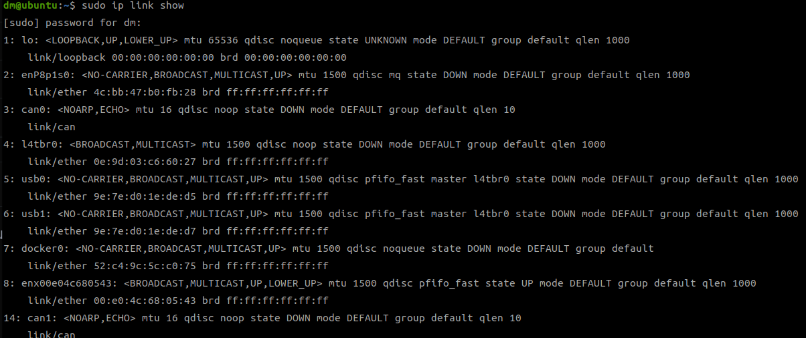
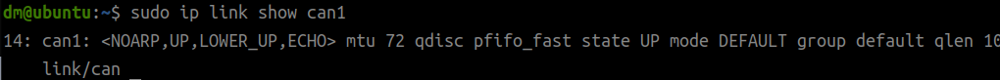

# SocketCAN Python例程

本目录提供基于 Linux SocketCAN 的 Python 电机控制示例，支持达妙单双路 USB2CANFD 模块。

USB2CANFD 模块需要烧录 SocketCAN 专用固件：[gs_usb固件安装](https://gitee.com/kit-miao/dm-tools/tree/master/USB2CANFD/%E5%9B%BA%E4%BB%B6/socketcan/gsusb%E5%85%8D%E9%A9%B1%E5%9B%BA%E4%BB%B6)，烧录方式与普通固件一致。

***注意：模块安装 SocketCAN 专用固件后，将无法连接使用上位机！若要使用上位机，请先刷回普通固件。***

如需刷回普通固件或升级 SocketCAN 固件，请下载 [USB2CANFD通用升级工具](https://gitee.com/kit-miao/dm-tools/tree/master/USB2CANFD%E9%80%9A%E7%94%A8%E5%8D%87%E7%BA%A7%E5%B7%A5%E5%85%B7)。


## 环境要求

Linux系统，若主控为 arm 架构，可能需安装的驱动：[gs_usb_drives](https://gitee.com/kit-miao/dm-tools/tree/master/gs_usb_drives)

## 1. 激活 USB2CANFD

插入 USB2CANFD 后，先确认系统识别到 CAN ：

```bash
sudo ip link show
```

***注意：arm 架构下，can0 可能是本机的 CAN 接口。***
***若确认 USB2CANFD 设备可以被系统发现，但仍没有发现模块的can口，则需要安装驱动 [gs_usb_drives](https://gitee.com/kit-miao/dm-tools/tree/master/gs_usb_drives)***
如果不确定哪个接口是 USB2CANFD，可以先拔出 USB2CANFD 模块，再执行 `sudo ip link show` 对比接口变化。

如果设备名是 `can1`，使用以下命令以 CAN FD 模式启动：

```bash
sudo ip link set can1 up type can bitrate 1000000 dbitrate 5000000 fd on
```

如果 `can1` 已经处于 up 状态，建议先关闭后重新配置：

```bash
sudo ip link set can1 down
sudo ip link set can1 type can bitrate 1000000 dbitrate 5000000 fd on
sudo ip link set can1 up
```

查看接口状态：

```bash
ip link show can1
```



## 2. 运行 test.py

进入仓库根目录：

```bash
cd Python例程
```

运行 Python 示例：

```bash
python3 Python例程/test.py
```
发现电机开始按一定速度转动，按 `Ctrl+C` 可以退出程序。

`test.py` 中默认使用 `can0`：

```python
robot_ptr1_ = Motor_Control("can0", init_data, Can_control_Mode.canfd)
```

如果 USB2CANFD 识别为 `can1`，请修改为：

```python
robot_ptr1_ = Motor_Control("can1", init_data, Can_control_Mode.canfd)
```

程序运行后会循环发送速度控制指令，并打印电机位置、速度、力矩和通信时间间隔。

##  新增电机型号

新增一款电机型号需要同时修改：

在`damiao_socketcan.py` 中 的 `DM_Motor_Type` 类中添加新型号，在 `limit_param` 数组中添加对应的限位参数。

### 添加枚举类型

在 `damiao_socketcan.py` 中 的 `DM_Motor_Type` 类中，在 `Num_Of_Motor` 之前添加新型号：

```python
class DM_Motor_Type(IntEnum):
    DM3507 = 0
    DM4310 = 1
    // ... 已有型号
    DMG6220 = 14
    DMxxxx = 15
    Num_Of_Motor = 16
```

注意：新型号要加在 `Num_Of_Motor` 之前，并且不要插在已有型号中间，否则已有型号的下标会改变，`limit_param` 会对应错。

### 添加 limit_param

在 `damiao_socketcan.py` 中 的 `limit_param` 数组末尾，按与枚举完全相同的顺序添加一组参数：

```python
limit_param = [
    limit_param(12.566, 50, 5),     // DM3507
    limit_param(12.5, 30, 10),      // DM4310
    // ... 已有型号
    limit_param(12.5, 45, 10),      // DMG6220
    limit_param(Q_MAX, DQ_MAX, TAU_MAX),   // DMxxxx
]
```
`Q_MAX`、`DQ_MAX`、`TAU_MAX` 分别对应该电机的位置、速度、力矩限位，可在上位机查看或修改，不能填 `0`。

### 注意

- 漏改枚举会编译失败；漏改 `limit_param` 会导致限位参数缺失。
- 枚举顺序与 `limit_param` 顺序必须一一对应，不要插队或换序。
- 限位参数必须根据实际情况填写，不要填 `0`。
