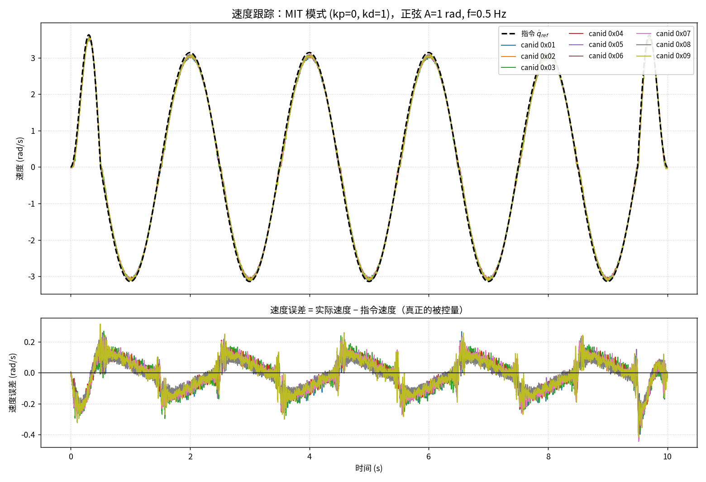

# DM Device SDK

General-purpose SDK for Damiao (DM) USB CAN(FD) devices: one native C library (`libdmcan`, plain C ABI)
plus **C/C++, C#, Python and Rust** wrappers. Classic CAN and CAN FD (BRS / TDC), periodic and batch
sending, multiple frame subscribers, bus state and statistics, USB2UART pass-through, hotplug events.

**Supported modules**: USB2CANFD_S (single, `0x34B7/0x6877`), USB2CANFD_D (dual, `0x34B7/0x6632`),
LinkX4C (quad, `0x34B7/0x4543`)
**Supported platforms**: Windows x64 (MinGW / MSVC), Linux (x86_64 / aarch64), macOS (Apple Silicon / Intel)

[中文](./README.md) | English

---

## 1. Pick your language

| Language | Entry point | What you get |
| --- | --- | --- |
| **C / C++** | [C&C++/README.md](C&C++/README.md) ・ tutorial [USAGE.md](C&C++/USAGE.md) ・ migration [UPDATE.md](C&C++/UPDATE.md) | Shared libraries, import libraries and headers for six platforms, per version under [lib/](C&C++/lib/); compile-ready examples in [example/](C&C++/example/) |
| **C# / .NET** | [CSharp/README.md](CSharp/README.md) | NuGet package [`DM_DeviceSDK_CSharp`](https://www.nuget.org/packages/DM_DeviceSDK_CSharp) (`net8.0`; native libraries ship inside the package — **no separate C SDK install**) |
| **Python** | [Python/README.md](Python/README.md) | PyPI package [`dmcan_sdk`](https://pypi.org/project/dmcan-sdk/) (pure ctypes, no build step; you supply the `libdmcan` backend library) |
| **Rust** | [Rust/README.md](Rust/README.md) | `dmcan` crate (not on crates.io yet — take the `.crate` from [Rust/pack/](Rust/pack/)) |

## 2. Current version and requirements

| Item | Value |
| --- | --- |
| Native library / headers | **2.1.0** (single source of truth: `dmcan_version.h`) |
| C# / Python package | 2.1.1 (metadata and docs only since 2.1.0; still binds the 2.1.0 backend) |
| Rust crate | 2.1.0 |
| Module firmware | **V2.0.0 or newer**, build id ≥ single `d64e840` / dual `b5c2574` / quad `d5bc7db` |
| Upgrading from 1.x | v2.x is **not source-compatible** with v1.1.0 — read [C&C++/UPDATE.md](C&C++/UPDATE.md) first |

The firmware version string stays `V2.0.0` and interface fixes do not bump it, so judge how new your
firmware is by the **build id** (read it with `dmcan_device_get_firmware_info()`). If in doubt, update
the firmware to the latest release.

## 3. Shortest path to a running program

- **C / C++**: compile-ready example in [`C&C++/example/v2.1.0/`](C&C++/example/v2.1.0/); integration steps and FAQ in [`USAGE.md`](C&C++/USAGE.md);
- **C#**: `dotnet add package DM_DeviceSDK_CSharp`, runnable demo in [`CSharp/demo/`](CSharp/demo/);
- **Python**: `pip install dmcan_sdk`, then place `libdmcan` where it can be found (see "how to place the backend library" in [`Python/README.md`](Python/README.md)); demo in [`Python/demo/`](Python/demo/);
- **Rust**: `tar -xf Rust/pack/dmcan-2.1.0.crate` and add it as a local dependency; demo in [`Rust/demo/`](Rust/demo/).

> Device not found or cannot be opened: on Windows another process usually holds the port; on Linux you
> need root or a udev rule; on macOS `libdmcan.dylib` and `libusb-1.0.0.dylib` must sit in the same
> directory. Each wrapper's README lists its full prerequisites.

## 4. Performance baseline (measured on real hardware)

| Scenario | Throughput | Frame / byte loss |
| --- | --- | --- |
| Single module, self send/receive (external loopback, no wiring) | **≈25.8 k frames/s** | 0 |
| Two modules back-to-back, 100 k frames one way | **26.4 k frames/s** | 0 |
| Two modules, 1 M frames each way + true echo | ≈13.9 k frames/s per direction | 0 |
| Quad module LinkX4C, one way (after firmware optimisation) | **22 k frames/s** | 0 |
| Quad module LinkX4C, 10 M frames each way | **24 k frames/s** combined | 0 |
| USB2UART pass-through, 3 Mbps | **~302 KB/s** | 0 |
| USB2UART pass-through, **6 Mbps (recommended)** | **583 KB/s** | **0** |
| USB2UART pass-through, 12 Mbps | **663 KB/s** | ~1.3‰ of bytes |

- CAN rows use 8-byte frames, CAN FD 1 Mbps @ 5 Mbps with BRS; USB2UART is available on the single and dual modules only (**not on LinkX4C**);
- Host cost is low: **0.78 µs/frame** of CPU — under 0.1% of one core at 1000 frames/s;
- Continuous data (sine stream at 1 kHz): **per-frame end-to-end latency p50 ≈ 1.8 ms**, 100% of frames received, no reordering, values matching frame by frame;
- Full tables and selection advice: [`docs/perf/PERFORMANCE_BASELINE.md`](docs/perf/PERFORMANCE_BASELINE.md).

Nine motors (canid `0x01`–`0x09`) driven over this SDK with a sine command: the top panel shows the command
speed `q_ref` (dashed) together with the measured speed of each motor, the bottom panel the speed error
(measured − command). Test conditions (chart title): MIT mode `kp=0 / kd=1`, sine amplitude `A = 1 rad`,
`f = 0.5 Hz`. All nine measured curves overlap the command and each other, with the error mostly inside
±0.2 rad/s — no node falls behind and the transport adds no visible distortion.

## 5. More

- **Skill for AI assistants**: [`skills/dmcan-sdk/SKILL.md`](skills/dmcan-sdk/SKILL.md) — artifact locations,
  native-library placement rules and a troubleshooting order per language;
- **Older versions**: C / C++ keeps [`lib/v1.1.0/`](C&C++/lib/v1.1.0/) and [`lib/v1.0.0/`](C&C++/lib/v1.0.0/);
  C# / Python keep their old packages under `pack/`;
- **Chinese version**: [`README.md`](./README.md); GitHub showcase mirror: `dmBots/dmBot`;
- **Tools & docs hub**: [dm-tools](https://gitee.com/kit-miao/dm-tools);
  Gitee / GitHub coverage differences: [mirror scope](https://gitee.com/kit-miao/damiao/blob/master/docs/repository/mirror-scope.md).
