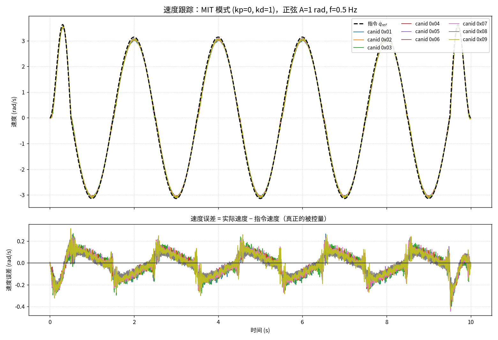

# DM Device SDK

达妙（DM）USB 系列 CAN(FD) 设备的通用 SDK：一套原生 C 库（`libdmcan`，纯 C ABI）加上
**C/C++、C#、Python、Rust** 四种封装。经典 CAN 与 CAN FD（BRS / TDC）、周期与批量发送、
多订阅者收帧、总线状态与统计、USB2UART 串口透传、热插拔通知。

**支持模块**：USB2CANFD_S（单路 `0x34B7/0x6877`）、USB2CANFD_D（双路 `0x34B7/0x6632`）、
LinkX4C（四路 `0x34B7/0x4543`）
**支持平台**：Windows x64（MinGW / MSVC）、Linux（x86_64 / aarch64）、macOS（Apple Silicon / Intel）

中文 | [English](./README.en.md)

---

## 1. 按你用的语言进入

| 语言 | 入口文档 | 交付形态 |
| --- | --- | --- |
| **C / C++** | [C&C++/README.md](C&C++/README.md) ・ 教程 [USAGE.md](C&C++/USAGE.md) ・ 版本迁移 [UPDATE.md](C&C++/UPDATE.md) | 六平台动态库 + 导入库 + 头文件，按版本在 [lib/](C&C++/lib/)；可直接编译的示例在 [example/](C&C++/example/) |
| **C# / .NET** | [CSharp/README.md](CSharp/README.md) | NuGet 包 [`DM_DeviceSDK_CSharp`](https://www.nuget.org/packages/DM_DeviceSDK_CSharp)（`net8.0`，原生库随包按平台分发，**不用另装 C SDK**） |
| **Python** | [Python/README.md](Python/README.md) | PyPI 包 [`dmcan_sdk`](https://pypi.org/project/dmcan-sdk/)（纯 ctypes，无编译依赖；后端库 `libdmcan` 自备） |
| **Rust** | [Rust/README.md](Rust/README.md) | cargo 包 `dmcan`（crates.io 尚未发布，从 [Rust/pack/](Rust/pack/) 取 `.crate`） |

## 2. 当前版本与要求

| 项 | 值 |
| --- | --- |
| 原生库 / 头文件 | **2.1.0**（版本唯一真源是 `dmcan_version.h`） |
| C# 包 / Python 包 | 2.1.1（相对 2.1.0 只有元数据与文档变化，绑定的后端仍是 2.1.0） |
| Rust crate | 2.1.0 |
| 模块固件 | **V2.0.0 及以上**，构建标识 ≥ 单路 `d64e840` / 双路 `b5c2574` / 四路 `d5bc7db` |
| 从 1.x 升级 | v2.x 与 v1.1.0 **接口不兼容**，先看 [C&C++/UPDATE.md](C&C++/UPDATE.md) |

固件版本号一直是 `V2.0.0`，接口相关的修正不改版本号，所以判断"固件够不够新"要看**构建标识**
（用 `dmcan_device_get_firmware_info()` 读回）。拿不准就直接升级到最新固件。

## 3. 最短上手路径

- **C / C++**：[`C&C++/example/v2.1.0/`](C&C++/example/v2.1.0/) 里有可直接编译的示例；接入步骤与常见问题见 [`USAGE.md`](C&C++/USAGE.md)；
- **C#**：`dotnet add package DM_DeviceSDK_CSharp`，可运行示例在 [`CSharp/demo/`](CSharp/demo/)；
- **Python**：`pip install dmcan_sdk`，再把 `libdmcan` 放到能被找到的位置（见 [`Python/README.md`](Python/README.md) 的"后端库怎么放"），示例在 [`Python/demo/`](Python/demo/)；
- **Rust**：`tar -xf Rust/pack/dmcan-2.1.0.crate` 后作为本地依赖引入，示例在 [`Rust/demo/`](Rust/demo/)。

> 打不开设备时先看平台前提：Windows 多半是被别的进程占用；Linux 默认要 root 或加一条 udev 规则；
> macOS 要保证 `libdmcan.dylib` 与 `libusb-1.0.0.dylib` 在同一目录。四种封装的完整前提见各自的 README。

## 4. 性能基线（真机实测）

| 场景 | 吞吐 | 丢帧 / 丢字节 |
| --- | --- | --- |
| 单模块自发自收（外部回环，不用接线） | **≈25.8 k 帧/s** | 0 |
| 两台模块对拉，单向 10 万帧 | **26.4 k 帧/s** | 0 |
| 两台模块对拉，双向各 100 万帧 + 真 echo | 每向 ≈13.9 k 帧/s | 0 |
| 四路模块 LinkX4C，单向（固件优化后） | **22 k 帧/s** | 0 |
| 四路模块 LinkX4C，双向各 1000 万帧 | 合计 **24 k 帧/s** | 0 |
| USB2UART 串口透传，3 Mbps | **~302 KB/s** | 0 |
| USB2UART 串口透传，**6 Mbps（推荐）** | **583 KB/s** | **0** |
| USB2UART 串口透传，12 Mbps | **663 KB/s** | 约 1.3‰ |

- CAN 部分为 8 字节帧、CAN FD 1 Mbps @ 5 Mbps 带 BRS；USB2UART 只有单路 / 双路模块有（**LinkX4C 没有**）；
- 主机侧开销小：SDK 每帧 CPU **0.78 µs/帧**，1000 帧/s 占不到 0.1% 的单核；
- 连续数据（正弦流，1 kHz）：**每帧端到端延迟 p50 ≈ 1.8 ms**，收帧 100%、无乱序、数值逐帧一致；
- 完整表格与选型建议见 [`docs/perf/PERFORMANCE_BASELINE.md`](docs/perf/PERFORMANCE_BASELINE.md)。

上图是 9 台电机（canid `0x01`–`0x09`）经本 SDK 传输正弦指令的实测跟踪：上图为指令速度 `q_ref`（虚线）
与各电机实测速度，下图为速度误差（实测 − 指令）。测试条件（图题）：MIT 模式 `kp=0 / kd=1`、
正弦幅值 `A = 1 rad`、`f = 0.5 Hz`。9 条实测曲线与指令几乎完全重合、彼此一致，
误差大多落在 ±0.2 rad/s 以内——没有节点掉队，也没有链路引入的畸变。

## 5. 其他

- **给 AI 助手用的技能**：[`skills/dmcan-sdk/SKILL.md`](skills/dmcan-sdk/SKILL.md)——按语言平台给出产物位置、
  原生库摆放要求与现场排错顺序，适合让助手直接照做；
- **历史版本**：C / C++ 保留 [`lib/v1.1.0/`](C&C++/lib/v1.1.0/) 与 [`lib/v1.0.0/`](C&C++/lib/v1.0.0/)；
  C# / Python 的旧包在各自 `pack/` 目录里；
- **英文版**：[`README.en.md`](./README.en.md)；GitHub 镜像展示仓：`dmBots/dmBot`；
- **工具资料总入口**：[dm-tools](https://gitee.com/kit-miao/dm-tools)；
  Gitee / GitHub 覆盖范围差异见[覆盖范围说明](https://gitee.com/kit-miao/damiao/blob/master/docs/repository/mirror-scope.md)。
