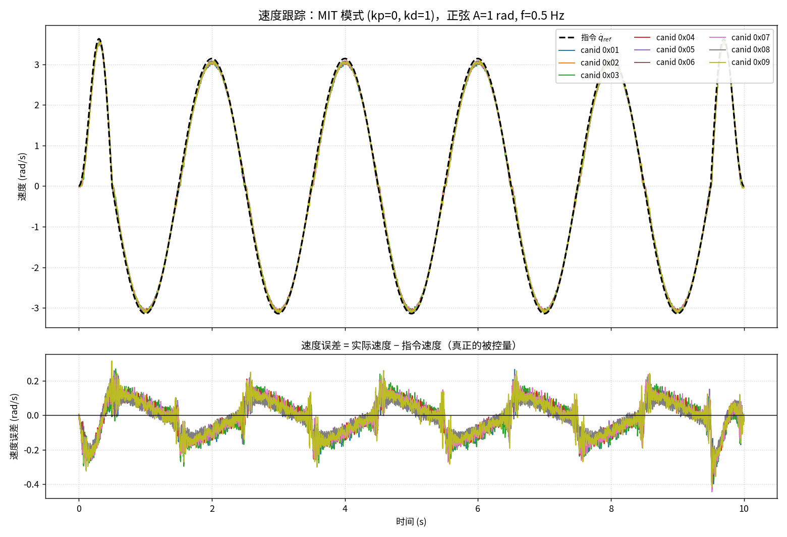

# 性能基线（实测）

真机 + 交付库实测，供选型与容量估算参考。被测模块：USB2CANFD_S（单路）/ USB2CANFD_D（双路）/
LinkX4C（四路）。CAN 部分为 8 字节帧、CAN FD 1 Mbps @ 5 Mbps 带 BRS。

## 1. CAN 收发吞吐

| 场景 | 吞吐 | 丢帧 |
| --- | --- | --- |
| 单模块自发自收（外设外部回环，不用接线） | **≈25.8 k 帧/s** | 0 |
| 两台模块对拉，单向 10 万帧 | **26.4 k 帧/s** | 0 |
| 两台模块对拉，双向各 100 万帧 + 真 echo | 每向 ≈13.9 k 帧/s | 0 |
| 四路模块 LinkX4C，单向（固件优化后） | **22 k 帧/s** | 0 |
| 四路模块 LinkX4C，双向各 1000 万帧 | 合计 **24 k 帧/s** | 0 |

- 判据：接收侧全部收齐，`tx_dropped` / `rx_dropped` / 错误计数全为 0；
- 上面的数字就是 **1 Mbps 标称 / 5 Mbps 数据段**下这条链路的实际上限（帧越短、速率越低，吞吐按比例下降）；
- **不接线也能测**：把通道设成外部回环（`mode = 2`）单模块即可跑出同量级吞吐（与对拉只差约 2%）。

## 2. USB2UART 串口透传吞吐

模块自带的 USB↔UART 桥，打开设备时按序列号自动匹配端口并打开（**只有单路 / 双路模块有，LinkX4C 没有**）。

| 波特率 | 吞吐 | 丢字节 | 建议 |
| --- | --- | --- | --- |
| 3 Mbps | **~302 KB/s** | 0 | 贴该档线速 |
| **6 Mbps** | **583 KB/s** | **0** | **推荐**：已接近这段链路的物理上限 |
| **12 Mbps** | **663 KB/s** | 约 1.3‰ | 吞吐优先、且能容忍极少量丢字节时用 |
| 9 / 15 / 20 Mbps | — | — | 不可用 |

- **两条链路可并行**：两台模块的 UART 交叉互连、双向同时对发，各自 ~302 KB/s、逐字节一致、
  合计 **~605 KB/s**，两条链路互不影响；
- **突发缓冲**：单路 **16 KB** / 双路 **8 KB**；超出缓冲的数据会被丢弃并计入 `rx_dropped`
  （不会反压串口），大块突发写入时请按这个容量规划。

## 3. 资源占用与延迟

| 指标 | 值 |
| --- | --- |
| SDK 每帧 CPU 开销（发送热路径） | **0.78 µs/帧**（MinGW Release）、**0.00 µs/帧**（MSVC Release） |
| 1 kHz 连续流：每帧端到端延迟 | **p50 ≈ 1.8 ms** |
| 1 kHz 连续流：丢帧 / 乱序 | **0 / 0** |

- 按 0.78 µs/帧算，**1000 帧/s 只占不到 0.1% 的单核**，主机侧余量很大；
- 20 ms / 1 ms / 200 µs / 不限速四档节拍都实测过：收到的帧数都是 **100.00%**，
  序号无缺失无乱序、数值逐帧吻合。

## 4. 曲线跟踪（9 台电机）

9 台电机（canid `0x01`–`0x09`）经本 SDK 传输正弦指令的实测跟踪：上图为指令速度 `q_ref`（黑虚线）
与各电机实测速度，下图为速度误差（实测 − 指令）。

- 测试条件（图题）：MIT 模式 `kp = 0 / kd = 1`、正弦幅值 **A = 1 rad**、**f = 0.5 Hz**，横轴 10 s；
- 9 条实测曲线与指令**几乎完全重合**、彼此高度一致（相位、幅值都对得上）：9 个节点在同一总线上
  同时被驱动时，没有哪个节点掉队，也看不到链路引入的畸变；误差大部分时间落在 ±0.2 rad/s 以内。

## 5. 一句话选型

| 你的需求 | 建议 |
| --- | --- |
| 单通道 CAN FD 打满 | ≈26 k 帧/s（1 Mbps 标称 / 5 Mbps 数据段） |
| 不想接线先自测 | 通道设成外部回环（`mode = 2`），单模块 ≈25.8 k 帧/s |
| 要"吞吐 + 0 丢" | UART 透传用 **6 Mbps**（583 KB/s） |
| 要更高吞吐、可容忍少量丢字节 | UART 透传用 **12 Mbps**（663 KB/s） |
| 四路同时跑 | 按合计 **24 k 帧/s** 规划总线负载 |
